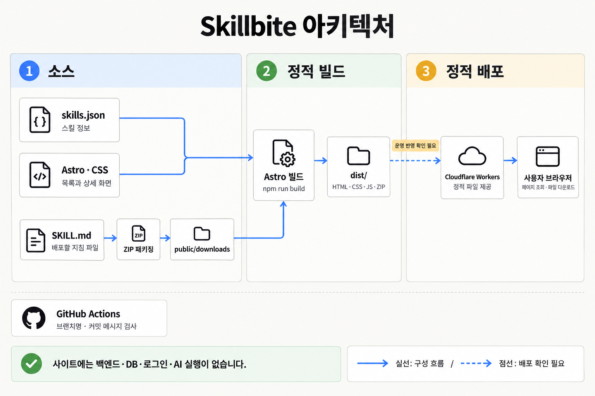
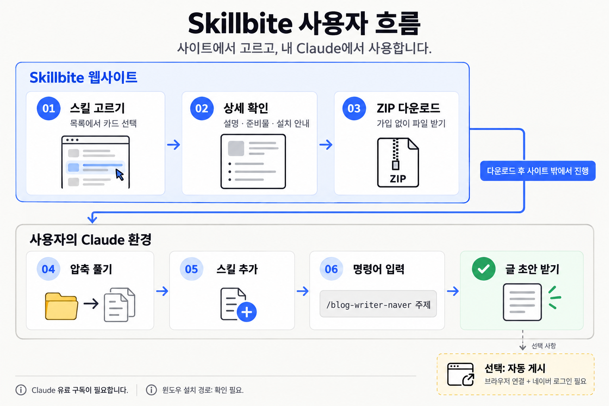

# SkillBite

**필요한 스킬을 고르고, 파일 하나로 Claude 활용을 시작하는 정적 스킬 마켓입니다.**

스킬은 AI에게 일하는 방법을 알려주는 지침 파일입니다. SkillBite는 비개발자가 스킬의 용도와 준비물을 확인한 뒤 ZIP 파일을 내려받고, 자신의 Claude 환경에 추가할 수 있도록 안내합니다.

사이트는 **목록 → 상세 → 다운로드** 두 화면으로 구성됩니다. 백엔드, 데이터베이스, 로그인, 결제, 사이트 안에서의 AI 실행은 없습니다.

## 만든 이유

블로그 글 작성, 워드 문서 정리, 엑셀 작업처럼 반복되는 일을 스킬 파일 하나에 담아 템플릿처럼 다시 쓸 수 있다는 점이 매력적이었습니다. 
개발자인 저에게는 익숙한 방식이었고, 주변 친구들도 자신의 일에 활용하면 좋겠다고 생각했습니다.

처음에는 사용법을 설명하는 유튜브 강의 링크를 보내줬습니다. 하지만 친구들은 “어려울 것 같다”며 시도 자체를 망설였습니다. 
AI에 익숙하지 않은 사람에게는 새로운 도구를 배우고 설치하는 과정부터 부담이 될 수 있었습니다. 
GitHub에서 파일을 찾거나 저장소를 복제하는 일도 처음 접하는 사람에게는 낯선 단계였습니다.

SkillBite는 그 첫 시도의 부담을 줄이기 위해 만들었습니다. 
필요한 스킬을 고르고, 파일을 내려받고, 설치 안내에 따라 지정된 폴더에 넣는 흐름으로 시작할 수 있게 합니다. 무엇을 받을지, 어디에 넣을지, 어떻게 실행할지를 한곳에서 설명해 첫 결과물을 얻기까지 안내하고 싶었습니다.

스킬은 글자로 된 지침이므로 사용자가 자신의 말투나 업무 방식에 맞게 내용을 바꿀 수도 있습니다. 
AI를 잘 모르는 비개발자도 작은 도움을 받아 반복 작업을 줄이고, 자신에게 맞는 활용법을 만들어 가는 것이 SkillBite의 목표입니다.

### 앞으로의 방향

먼저 비개발자가 스킬을 직접 설치하고 활용할 수 있는지 확인하며 안내를 다듬으려고 합니다. 이후에는 사용자가 직접 만든 스킬이나 수정한 버전을 공유할 수 있는 공간으로 확장하고 싶습니다.

장기적으로는 GitHub Marketplace처럼 스킬을 발견하고, 자신에게 맞게 만든 스킬을 사고팔 수 있는 마켓을 구상하고 있습니다. 
유료 거래가 이루어지면 일정 수수료를 받는 방식도 검토할 계획입니다. 
공유·판매·결제는 아직 구현하지 않은 향후 구상이며, 현재 버전은 파일 다운로드와 설치 안내에 집중합니다.

## 현재 진행 상황

2026년 10월 22일 기준입니다. 코드 반영과 운영 배포 상태를 구분해 기록합니다.

| 항목 | 상태 |
| --- | --- |
| 목록·상세 화면 | 승인한 시안을 기준으로 개선 완료 |
| 제공 스킬 | `blog-writer-naver` 1개 |
| 다운로드 | 폴더 구조를 유지한 ZIP 파일 제공 |
| 맥 설치 안내 | 저장소에 확인된 경로와 재시작 불필요 안내 반영 |
| 윈도우 설치 경로 | `[확인 필요]` |
| 결과물 예시 | 실제 실행 결과와 구분한 글 구성 예시 제공 |
| 실제 결과물 스크린샷 | 준비 중 |
| 빌드·주요 동작·반응형 검증 | 통과 |
| 화면 캡처 기반 픽셀 비교 | 도구 오류로 미완료 |
| Git Flow 반영 | 기능 PR → `dev` → 릴리스 PR → `main` 머지 완료 |
| Cloudflare 운영 배포 | 최신 화면 반영 미확인. 연결 설정과 빌드 이력 확인 필요 |

### 최근 반영 내역

| PR | 변경 | 머지 경로 |
| --- | --- | --- |
| [#11](https://github.com/thrkrif/skillbite/pull/11) | Cloudflare 브랜치 미리보기 설정 | `dev`에 반영 후 릴리스에 포함 |
| [#12](https://github.com/thrkrif/skillbite/pull/12) | 스킬 마켓 목록·상세 화면 개선 | `feature/frontend-redesign` → `dev` |
| [#13](https://github.com/thrkrif/skillbite/pull/13) | 0.3.0 프론트 개선 릴리스 | `release/0.3.0` → `main` |

프론트 개선의 `dev` 반영 커밋은 `8bcd106`, `main` 릴리스 머지 커밋은 `619b46d`입니다. **머지 완료가 Cloudflare 운영 배포 완료를 뜻하지는 않습니다.**

## 화면과 주요 기능

| 화면 | 경로 | 주요 기능 |
| --- | --- | --- |
| 스킬 목록 | `/` | 소개 도해, 스킬 카드, 준비 중 카드, 사용 방법 안내 |
| 스킬 상세 | `/skills/:id` | 다운로드, 파일 미리보기, 결과물 예시, 준비물, 설치 안내, FAQ |

- 스킬 카드를 누르면 해당 상세 페이지로 이동합니다.
- 스킬이 3개 이상이면 데이터의 분류를 바탕으로 카테고리 필터를 표시합니다.
- 파일 미리보기와 FAQ는 JavaScript 없이도 열 수 있습니다.
- 설치 안내에는 운영체제 선택과 명령어 복사 기능이 있습니다. 복사 실패도 별도로 안내합니다.
- 모바일에서는 한 열, 태블릿에서는 두 열, 데스크톱에서는 세 열로 목록을 표시합니다.
- 무료는 **스킬 파일 다운로드**에 대한 설명입니다. Claude 유료 구독은 별도로 필요합니다.

디자인 기준은 [DESIGN.md](DESIGN.md), 승인한 시안과 검증 내역은 [프론트 개선 문서](docs/design/frontend-refresh/README.md)에서 확인하실 수 있습니다.

## 아키텍처



이 그림은 저장소 구조를 설명하는 이미지이며, 운영 배포가 완료됐다는 증거는 아닙니다.

1. `src/data/skills.json`이 카드, 상세 페이지, 준비물과 FAQ의 정보를 제공합니다.
2. Astro 페이지와 컴포넌트가 데이터를 읽고, 순수 CSS로 화면을 구성합니다.
3. `skills/<id>/SKILL.md`를 ZIP으로 묶어 `public/downloads/`에 준비합니다. ZIP 생성은 빌드와 별도의 작업입니다.
4. `npm run build`가 정적 HTML·CSS·JS와 공개 파일을 `dist/`에 출력합니다.
5. `wrangler.jsonc`는 Cloudflare Workers가 `dist/`의 정적 파일을 제공하도록 설정합니다. 실제 운영 반영 여부는 Cloudflare 배포 이력에서 확인해야 합니다.

사용자는 브라우저에서 페이지와 파일을 받습니다. 파일을 적용한 뒤의 AI 실행은 사용자의 Claude 환경에서 이루어집니다. GitHub Actions는 현재 브랜치명과 커밋 메시지만 검사하며, 저장소에 별도의 배포 워크플로는 없습니다.

### 기술 구성

| 구분 | 사용 기술 |
| --- | --- |
| 사이트 생성 | Astro 6, 정적 출력 |
| 스타일 | 순수 CSS, 공통 디자인 토큰 |
| 데이터 | JSON 파일 |
| 글꼴 | 로컬 Pretendard, JetBrains Mono |
| 파일 패키징 | Node.js 스크립트와 `zip` 명령 |
| 배포 구성 | Cloudflare Workers의 정적 파일 제공 |
| Git 검사 | Husky, commitlint, GitHub Actions |

## 사용자 흐름



1. 목록에서 필요한 스킬을 고릅니다.
2. 상세 페이지에서 설명, 예시, 준비물과 설치 안내를 확인합니다.
3. ZIP 파일을 내려받고 압축을 풉니다.
4. 안내된 위치에 스킬 폴더를 넣습니다.
5. Claude에서 `/blog-writer-naver 주제`처럼 명령어를 입력합니다.
6. 글 초안을 받습니다. 자동 게시를 쓰려면 브라우저 연결과 네이버 로그인이 추가로 필요합니다.

사이트 자체가 글을 생성하거나 네이버에 게시하지는 않습니다. 초안 작성과 자동 게시의 조건은 상세 페이지에서 구분해 안내합니다.

## 로컬 실행

Node.js **22.12.0 이상**과 npm이 필요합니다. 아래 명령은 저장소 루트에서 실행합니다.

```bash
npm ci
npm run dev
```

개발 서버의 기본 주소는 `http://localhost:4321`입니다. 포트가 이미 사용 중이면 터미널에 표시되는 실제 주소를 확인해 주세요.

- 목록: `http://localhost:4321/`
- 첫 스킬 상세: `http://localhost:4321/skills/blog-writer-naver`

### 자주 쓰는 명령어

| 명령어 | 역할 |
| --- | --- |
| `npm run dev` | 로컬 개발 서버 실행 |
| `npm run build` | `dist/`에 정적 사이트 생성 |
| `npm run preview` | 빌드 결과를 로컬에서 확인 |
| `npm run zip` | 스킬 원본을 다운로드용 ZIP으로 패키징 |
| `npm run lint:branch` | 현재 브랜치 이름 검사 |
| `git diff --check` | 변경 파일의 공백 오류 검사 |

`npm run zip`은 시스템의 `zip` 명령을 사용합니다. 스킬 원본을 수정했다면 ZIP을 먼저 다시 만들고 사이트를 빌드해 주세요.

```bash
npm run zip
npm run build
npm run preview
```

현재 `npm run lint`나 자동화 테스트 스크립트는 정의돼 있지 않습니다. PR의 `lint` 워크플로는 브랜치명과 커밋 메시지를 검사합니다.

## 폴더 구조

```text
skillbite/
├── src/
│   ├── components/          # 카드, 설치 안내, FAQ 등
│   ├── data/
│   │   ├── skills.json     # 스킬 정보
│   │   └── install.js      # 확인된 설치 값과 미확인 표시
│   ├── layouts/Base.astro  # 공통 탐색과 페이지 틀
│   ├── pages/
│   │   ├── index.astro     # 목록
│   │   └── skills/[id].astro
│   └── styles/global.css   # 공통 스타일과 토큰
├── skills/                 # 배포할 SKILL.md 원본
├── public/
│   ├── downloads/          # 다운로드용 ZIP
│   └── icons/              # 스킬 아이콘
├── scripts/                # ZIP 생성, 브랜치명 검사
├── docs/                   # 기획, 설계, 시안, 다이어그램
├── .github/workflows/      # PR 검사
├── DESIGN.md               # 디자인 기준
├── AGENTS.md               # 에이전트 작업 규칙
├── astro.config.mjs        # 정적 출력 설정
└── wrangler.jsonc          # Workers 정적 파일 설정
```

`dist/`는 빌드 결과이며 Git에 포함하지 않습니다. `.omx/`는 로컬 도구의 작업 기록으로, 제품 소스나 필수 실행 파일이 아닙니다.

## 스킬 추가 방법

화면 코드를 수정하지 않고 **데이터 항목과 파일**을 추가하는 구조입니다.

1. `skills/<id>/SKILL.md`에 사람이 읽을 수 있는 지침을 작성합니다.
2. 아이콘 등 공개 파일을 준비하고 `src/data/skills.json`에 기존 스킬과 같은 형식으로 항목을 추가합니다.
3. `id`, `title`, `summary`, `icon`, `category`, `tags`, `command`, `downloadUrl`, `requirements`, `capabilities`, `exampleImages`, `faqs`를 채웁니다.
4. 실제 결과 이미지가 없으면 선택 필드 `examplePreview`로 구성 예시를 제공할 수 있습니다. 실제 실행 결과가 아니라는 표시를 유지합니다.
5. `npm run zip`과 `npm run build`를 실행하고 목록, 상세 경로와 다운로드를 확인합니다.

ZIP 안의 구조는 다음과 같습니다.

```text
<id>/
└── SKILL.md
```

설치 경로나 앱 재시작 여부는 확인된 값만 안내합니다. 미확인 값은 `[확인 필요]`로 남깁니다. 배포할 지침에는 개인 정보, 내부 경로, 키나 실제 사용자 데이터를 넣지 않습니다.

## Git Flow와 검사 규칙

`main`은 배포 브랜치, `dev`는 통합 브랜치입니다. 두 브랜치에 직접 push하지 않고 PR로 변경합니다.

```text
dev
 └─ feature/* 또는 docs/* 등 작업 브랜치
     └─ PR → dev
         └─ release/*
             └─ PR → main
```

- 기능 브랜치를 `main`에 바로 머지하지 않습니다.
- `release/*`는 `dev`에서 분기합니다. 릴리스에서 추가 수정이 발생하면 해당 수정도 `dev`에 반영해야 합니다.
- 운영 긴급 수정은 `main`에서 `hotfix/*`를 만들고 `main`과 `dev` 양쪽에 반영합니다.
- 브랜치 이름은 허용된 접두사와 소문자·숫자·`.`·`_`·`-`를 사용합니다.
- 커밋 메시지는 `feat: 스킬 카드 개선`, `docs: README 정리`처럼 Conventional Commits 형식을 따릅니다.
- 로컬 Husky와 PR 검사를 통과해야 하며 `--no-verify`로 우회하지 않습니다.

세부 규칙은 [AGENTS.md](AGENTS.md), [브랜치 검사 스크립트](scripts/check-branch-name.sh), [커밋 검사 설정](commitlint.config.js)을 참고해 주세요.

## Cloudflare 배포 상태와 확인 방법

초기 기획 문서는 Cloudflare Pages를 전제로 작성됐지만, 현재 저장소와 확인한 대시보드 대상은 **Cloudflare Workers**입니다. 정적 사이트라는 제품 범위는 그대로 유지합니다.

현재 `wrangler.jsonc`의 주요 설정은 다음과 같습니다.

```jsonc
{
  "name": "skillbite",
  "assets": {
    "directory": "./dist",
    "not_found_handling": "404-page"
  },
  "previews": {}
}
```

### 확인된 사실

- 프론트 개선 코드는 PR을 거쳐 `dev`와 `main`에 머지됐습니다.
- 로컬 정적 빌드는 통과했습니다.
- GitHub Actions에는 린트 워크플로만 있습니다.
- 대시보드의 실제 Git 연결, 빌드 로그와 운영 배포 버전은 로그인 상태에서 확인하지 못했습니다.
- 따라서 최신 화면이 운영에 반영되지 않은 원인은 아직 확정하지 않았습니다.

### Workers Builds를 사용할 때 확인할 설정

Cloudflare에서 **Workers & Pages → Skillbite → Settings → Build**를 확인합니다. 아래 표는 이 저장소에 맞는 확인 기준이며, 대시보드에 이미 저장됐다고 확인한 값은 아닙니다.

| 항목 | 확인 기준 |
| --- | --- |
| 저장소 | `thrkrif/skillbite` |
| 운영 브랜치 | `main` |
| Build command | `npm run build` |
| Deploy command | `npx wrangler deploy` |
| Root directory | 저장소 루트 |
| 정적 파일 경로 | `wrangler.jsonc`의 `./dist` |

배포 이력에서 `main`의 릴리스 커밋 `619b46d` 또는 그 이후 커밋이 빌드·배포됐는지 확인해야 합니다. 미리보기 URL이나 도메인 연결만으로 운영 배포 완료를 판단하지 않습니다. 운영 반영 후에는 목록, 상세 경로 직접 접속, ZIP 다운로드를 다시 확인합니다.

Workers Builds 설정에 관한 설명은 [Cloudflare 공식 문서](https://developers.cloudflare.com/workers/ci-cd/builds/configuration/)를 참고해 주세요. 로컬 실행에는 서비스 비밀 키가 필요하지 않으며, 배포 인증 정보는 코드나 README에 적지 않습니다.

## 검증 결과와 남은 작업

### 확인한 항목

- 정적 빌드와 브랜치명·커밋 메시지 검사 통과.
- 목록·상세 각각 1440, 768, 390, 320px 폭에서 가로 넘침 없음.
- 카드 이동, 파일 미리보기, OS 전환, FAQ 키보드 조작, 복사 성공·실패, 실제 ZIP 다운로드 등 12개 동작 확인.
- JavaScript가 없어도 설치 안내와 FAQ에 접근 가능.
- 독립 소스 리뷰에서 새 기능의 차단 결함 없음.

### 남은 항목

- [ ] Cloudflare 연결 설정·빌드 로그 확인과 운영 최신 반영 검증
- [ ] 실제 생성 결과물 이미지와 설치 스크린샷 준비
- [ ] 윈도우 설치 경로 검증
- [ ] 화면 캡처 도구 정상화 후 픽셀 차이 검증
- [ ] 피드백 URL과 최종 로고 확정
- [ ] 비개발자 친구 테스트 진행
- [ ] 설치 FAQ의 중복 값과 OS 선택자 범위 정리

설치 쇼츠 영상과 익명 통계는 후속 범위입니다. 현재 코드에 외부 분석 도구를 추가하지 않았습니다.

## 관련 문서

| 문서 | 내용 |
| --- | --- |
| [AGENTS.md](AGENTS.md) | 작업 원칙, 보안, Git Flow |
| [DESIGN.md](DESIGN.md) | 최신 디자인 기준과 반응형 규칙 |
| [PLAN](docs/PLAN.md) | 초기 정의, 가설과 성공 기준 |
| [PRD](docs/PRD.md) | 요구사항과 수용 기준 |
| [HANDOFF](docs/HANDOFF.md) | 구조와 데이터 스키마 |
| [TASKS](docs/TASKS.md) | 초기 단계별 계획 |
| [SKILL_SPEC](docs/SKILL_SPEC.md) | 첫 스킬의 파일 기준 |
| [CONTENT_AND_TEST](docs/CONTENT_AND_TEST.md) | 콘텐츠와 친구 테스트 계획 |
| [프론트 개선 기록](docs/design/frontend-refresh/README.md) | 승인 시안과 구현 검증 |
| [이미지 생성 기록](docs/images/PROMPTS.md) | 아키텍처·사용자 흐름 이미지의 원본 프롬프트 |

초기 기획·체크리스트에는 구현 전 내용이 남아 있습니다. 현재 상태는 이 README의 기준일과 실제 코드를 함께 확인해 주세요. 설명용 다이어그램은 내장 `image_gen` 도구로 생성했습니다.
